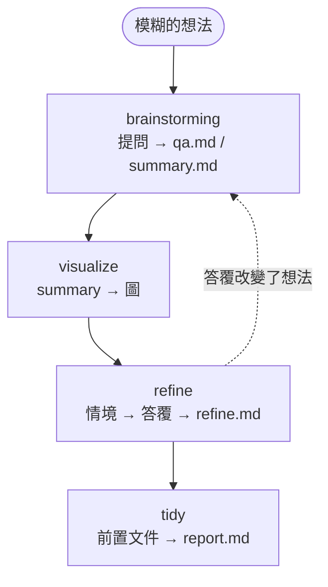

# tidy-up-your-thoughts

A Hermes plugin that turns a vague idea into a detailed report and a picture of it, through a fixed
sequence of steps rather than a good conversation. Five bundled skills, one per stage: ask, stress,
draw, write, and — when the sequence itself misfires — fix the sequence.

## Install

```bash
hermes plugins install Uniterra-Solutions/tidy-up-your-thoughts --enable
```

Skills register under the plugin namespace, so they are called by qualified name:

```bash
skill_view("tidy-up-your-thoughts:brainstorming")
```

Disabling removes them from the index and deletes nothing:

```bash
hermes plugins disable tidy-up-your-thoughts
```

**Developing from a checkout.** `hermes plugins install` takes a catalog name, a git URL or
`owner/repo` — never a bare local path. Link the working copy in instead:

```bash
ln -sfn ~/tidy-up-your-thoughts "$HERMES_HOME/plugins/tidy-up-your-thoughts"
hermes plugins enable tidy-up-your-thoughts
```

Adding a skill to an already-enabled plugin does not reach a running gateway on its own:
`hermes plugins disable <name>` then `enable` forces the reload.

## Design

The plugin exists because a thought becomes clear in stages, and each stage is a different kind of
work with a different failure. One conversation does all of them badly.

| Stage | Skill | The work | Its characteristic failure |
| --- | --- | --- | --- |
| Ask | `brainstorming` | Socratic questioning that keeps every question at a layer the user can answer from his own experience | questions so specific they supply the answer's vocabulary |
| Stress | `refine` | several read-only subagents, one lens each, return concrete situations the idea would have to survive | a risk register with no moment in it |
| Draw | `visualize` | the summary rendered as mermaid: composition, forks, argument chains, trade-offs, the shape of the thinking | a picture that asserts what the prose never did |
| Write | `tidy` | one report for a reader who was not there | a transcript with headings |
| Fix the process | `report` | an incident turned into one anti-pattern and one class of change | an apology |



`report` is not a stage in that chain: it repairs any stage that misfired, and it is described below.

Three invariants hold across every stage, and they are what make the output trustworthy:

1. **The agent does not answer for the user.** It asks, mirrors, records. Where a decision is needed,
   the user makes it; the agent's own reading is always labelled as the agent's.
2. **A blank stays blank.** A question that went unanswered is recorded as unanswered, with its id.
   The record never grows a position nobody took.
3. **Every substantive sentence traces to an entry.** `[Qn]` for an exchange, `[Sxx]` for a situation.
   A claim that cannot be traced is either a transition or it does not belong in the document.

The record accumulates in `~/thoughts/<topic_name>/`, one file per stage, append-only. Corrections
amend the upstream file rather than patching the artefact downstream — a diagram that disagrees with
the summary is corrected in the summary, then regenerated.

## Skills

| Qualified name | What it does |
| --- | --- |
| `tidy-up-your-thoughts:brainstorming` | Socratic questioning that keeps every question at the abstract layer an outsider could answer, mirrors each answer back for correction, and writes the whole exchange to `~/thoughts/<topic_name>/` as a declarative record (`qa.md`, `summary.md`, `README.md`) — negation only after the steelman it refutes has been built in full |
| `tidy-up-your-thoughts:refine` | Stress-tests the idea against the world: four read-only subagents, one lens each (steelman / mechanism / premise audit / failure mode), return concrete situations rather than risks; the main agent verifies each quote against the summary, merges by decision point and keeps the convergence count, then asks one situation at a time and records the answers. Writes `refine.md` — settled verdicts with observable criteria, and the blanks left blank |
| `tidy-up-your-thoughts:visualize` | Reads the summary and draws it: a mind map for composition, a decision flow for forks, an argument chain that puts the negation last, a quadrant for a trade-off, a timeline for how the thinking moved — two to four diagrams, every node traceable to a summary line, open questions dashed. Renders PNG + SVG, checks provenance mechanically, and folds corrections back into `summary.md` and `REVISIONS.md` rather than patching the picture |
| `tidy-up-your-thoughts:tidy` | Turns the whole topic folder into `report.md` for a reader who was not there: every statement traced to `[Qn]` / `[Sxx]`, ordered by support rather than chronology, domain terms verified against the instrument that defines them. Topic sentence per paragraph, declarative sentences, negation admitted only inside a rebuttal that first builds the counter-argument in full |
| `tidy-up-your-thoughts:report` | Meta skill for when the workflow itself misfired: finds the guideline that produced the wrong action (quoted with file and line, or names the missing one), extracts one abstract anti-pattern with six fields, then applies exactly one class of fix — prompt, information, code or process — in the same session, and appends it to an anti-pattern index with a regression criterion. The same skill ships in `pdd` as `pdd:report` |

### Why `report` exists

A skill that can change itself is a skill that can drift, and drift is invisible from the inside. The
mechanism that keeps it honest is the same one that keeps the other four honest: a change has to be
readable by someone who did not make it.

Every fix therefore carries three things a reviewer can check without re-running the session:

- **the guideline it answers**, quoted with file and line — so the change lands where the mistake was
  caused, not where it was noticed;
- **one abstract anti-pattern**, with the reason the wrong action looked right — so the reviewer can
  judge whether the class of failure was understood or just this instance;
- **a regression criterion**, stating what observable thing will differ next time — so "fixed" is a
  claim someone else can falsify.

The same discipline lets the agent report its own problems instead of waiting to be caught: an
incident becomes a report in `~/thoughts/<topic>/friction/` (or `docs/retro/` under `pdd`), an entry
in the index, and an applied fix in the same session. Self-repair that leaves a paper trail is
reviewable; self-repair that leaves none is indistinguishable from drift.

## The topic folder

```
~/thoughts/<topic_name>/
├── README.md        the topic in one line, opened date, open threads
├── qa.md            append-only transcript, Q1..Qn, no gaps
├── summary.md       what the topic establishes, each line with [Qn] provenance
├── diagrams/        *.mmd sources, rendered *.png / *.svg, visual.md captions, REVISIONS.md
├── refine.md        the situations the idea met, what was settled, what was left blank
├── refine-raw/      one verbatim return per lens — the merge is auditable only while these survive
├── report.md        the deliverable for a reader who was not there
└── friction/        incident reports about the process itself
```

## Repository layout

```
plugin.yaml                    manifest: name, version, description, licence
__init__.py                    register(ctx) — one register_skill() per skills/<dir>/SKILL.md
skills/brainstorming/
├── SKILL.md                   the workflow and the three laws
└── references/
    ├── question-patterns.md   fourteen Socratic moves, with failure modes
    └── writing-rules.md       declarative voice, the negation protocol, the closing lint

skills/refine/
├── SKILL.md                   dispatch lenses → ask one situation at a time → write refine.md
├── references/lenses.md       eight lenses, how to pick four, how convergence is used
├── assets/subagent-brief.md   the brief, dispatched verbatim, with the failures it prevents
└── scripts/check_refine.py    verdicts, [Qn] refs, consensus counts, qa numbering, raw returns

skills/visualize/
├── SKILL.md                   draw the summary, then fold corrections back into it
├── references/mermaid-templates.md   eight rendered types, one sample topic, the syntax that bites
└── scripts/render.py          render diagrams/*.mmd → png + svg; enforce the `%% source:` header

skills/tidy/
├── SKILL.md                   read everything → verify vocabulary → write report.md
├── references/terminology.md  source hierarchy, the record format, terms that mean two things
├── assets/report-template.md  the skeleton, a paragraph that holds, a rebuttal block
└── scripts/check_report.py    negatives outside a rebuttal, advice wording, citations, spine

skills/report/
├── SKILL.md                   incident → guideline → anti-pattern → one class of fix
├── references/gate-discipline.md   five rules for trusting a checker's green run
├── assets/report-template.md  the skeleton, with what each section is for
└── scripts/
    ├── check_friction.py      citation, six fields, one class, process argument, regression
    └── check_issue.py         publish gate: paths, contacts, revisions, deny words, redaction line
```

Each script is a mechanical shadow of its skill's rules — the checks a reader would otherwise have to
make by hand: a diagram with no source, an answer citing an exchange that does not exist, a negation
outside a rebuttal, a fix with no regression criterion. They are meant to be run, not just shipped.

## Adding a skill

1. Create `skills/<name>/SKILL.md` with at least `name` and `description` in the frontmatter:

   ```yaml
   ---
   name: <name>
   description: "Use when <trigger>. <what it does>."
   version: 0.1.0
   author: Tsz Kin Lai (LaiTszKin), Hermes Agent
   license: MIT
   platforms: [linux, macos, windows]
   metadata:
     hermes:
       tags: [thinking, <topic>]
   ---
   ```

   `description` is the only line the model matches on in `<available_skills>`; `__init__.py` reads it
   out of the frontmatter and forwards it to `ctx.register_skill`, so a wrong description means a skill
   nobody loads.
2. Supporting material goes beside it, never in a flat pile: `references/<topic>.md`,
   `assets/<template>`, `scripts/<tool>`.
3. Bump `version` in `plugin.yaml`, commit, and reload (`disable` then `enable`).

## What "bundled" buys you

- The skills live in the plugin registry, **not** in `~/.hermes/skills/`. They are read-only:
  `skill_manage`, the curator and background review passes cannot edit them.
- They still appear in `skills_list` and in the system prompt's `<available_skills>` index while the
  plugin is enabled, under their qualified names.
- The qualified name is what resolves unambiguously; a bare `skill_view("name")` can still hit an
  on-disk skill of the same name.

## Verifying a change

```bash
# 1. manifest, register() run in isolation, security scan — the cheap gate
hermes plugins validate .

# 2. what the live plugin manager actually registered (use the interpreter that carries Hermes's own
#    dependency closure; a plain python3 dies on ruamel)
VP=$(ls -d ~/.hermes/installs/*/environments/*/venv/bin/python3 | head -1)
env -u PYTHONPATH "$VP" - <<'PY'
import sys; from pathlib import Path
sys.path.insert(0, str(Path.home()/".hermes/hermes-agent"))
from hermes_cli.plugins import get_plugin_manager
pm = get_plugin_manager(); pm.discover_and_load()
print(sorted(pm._plugins))
for name, meta in sorted(pm._plugin_skills.items()):
    print(name, "|", meta.get("description", "")[:70])
PY
```

Then, in a **new** session, confirm `skills_list` shows the qualified names — registration is
per-process, so the session that already ran keeps its snapshot.

## Licence

MIT, Uniterra Solutions Ltd.