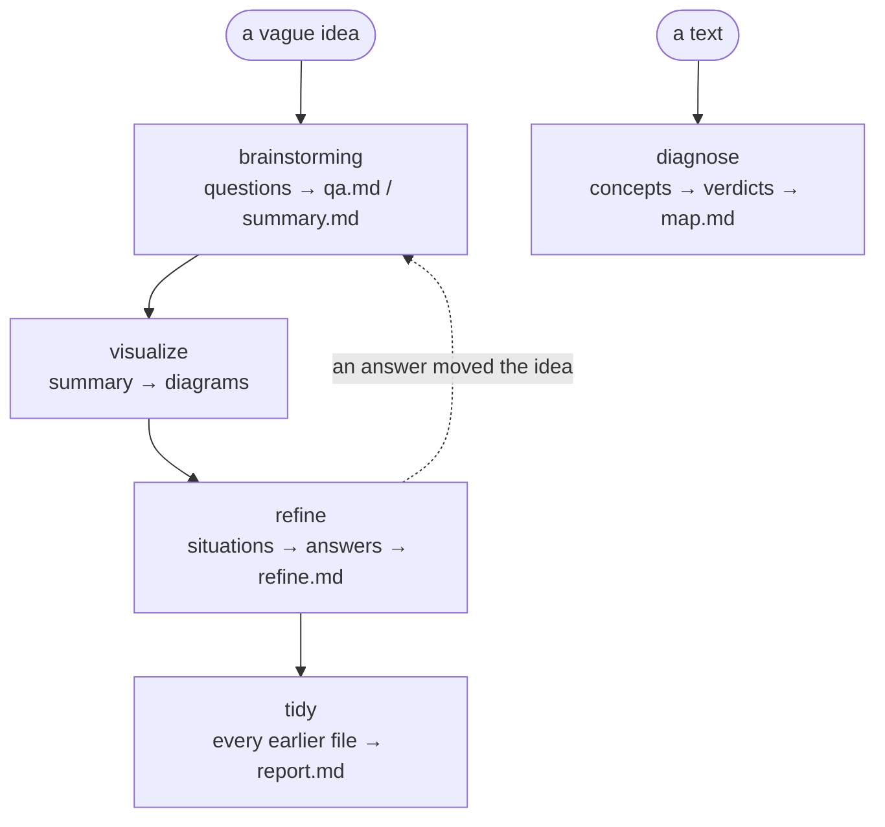

# tidy-up-your-thoughts

Turns a vague idea into a detailed report and a picture of it, through a fixed sequence of steps rather
than a good conversation. Five skills, one per stage: ask, stress, draw, write, and — when the sequence
itself misfires — fix the sequence. A sixth, `diagnose`, is a second entry point for the other kind of
reading: a text in hand, and no way to tell whether it went in.

One `skills/` tree at the repo root is the only copy of the content. Four manifests point at it, so the
same six skills install into Hermes Agent, Muse, Claude Code and Codex — and into Grok Build, xAI's CLI —
with every host namespacing them as `tidy-up-your-thoughts:<skill>`.

## Install

### 1. Hermes Agent

```bash
hermes plugins install Uniterra-Solutions/tidy-up-your-thoughts --enable
```

`plugin.yaml` and `__init__.py` are the Hermes manifest: `register(ctx)` reads each `skills/<name>/SKILL.md`,
forwards its `description` and calls `ctx.register_skill()`, so the skills load from the plugin registry rather
than from `~/.hermes/skills/`, stay read-only to `skill_manage` and the curator, and appear in the skill index
under their qualified names while the plugin is enabled. A running gateway keeps the registration it started
with — `hermes plugins disable <name>` then `enable` forces the reload.

```text
skill_view("tidy-up-your-thoughts:brainstorming")
skill_view("tidy-up-your-thoughts:tidy", "references/terminology.md")
```

`hermes plugins install` takes a catalog name, a git URL or `owner/repo` — never a bare local path. To work
from a checkout, link it in instead:

```bash
ln -sfn ~/tidy-up-your-thoughts "$HERMES_HOME/plugins/tidy-up-your-thoughts"
hermes plugins enable tidy-up-your-thoughts
```

### 2. Muse

```bash
muse plugins marketplace add tidy-up-your-thoughts Uniterra-Solutions/tidy-up-your-thoughts
muse plugins install tidy-up-your-thoughts@tidy-up-your-thoughts
muse plugins approve tidy-up-your-thoughts
```

From a local checkout, without the marketplace step:

```bash
muse plugins install "$(pwd)/plugins/tidy-up-your-thoughts" --scope user
muse plugins approve tidy-up-your-thoughts
muse skills list          # expect the six skills
```

`plugins/tidy-up-your-thoughts/.muse-plugin/plugin.json` declares `schemaVersion: 1` and lists every skill by
`{"id", "path"}` under `capabilities` — Muse does not discover a directory on its own, so the list is the
contract. Plugins and marketplaces are on by default in current Muse builds; on an older build where
`muse plugins --help` refuses the command, set `MUSE_EXPERIMENTAL_PLUGINS=1`.

Muse also reads skills that no plugin installed, in this order: `~/.agents/skills`, then `~/.claude/skills`,
then `~/.codex/skills`. A machine that already installed this package for Claude Code or Codex therefore
reaches Muse with no extra step; `muse skills import --from claude` copies them explicitly instead.

### 3. Claude Code

```text
/plugin marketplace add Uniterra-Solutions/tidy-up-your-thoughts
/plugin install tidy-up-your-thoughts@tidy-up-your-thoughts
```

The same two steps from a shell, or against a local checkout instead of GitHub:

```bash
claude plugin marketplace add Uniterra-Solutions/tidy-up-your-thoughts   # or: add ./tidy-up-your-thoughts
claude plugin install tidy-up-your-thoughts@tidy-up-your-thoughts
claude plugin details tidy-up-your-thoughts   # expect: Skills (6) brainstorming, diagnose, … visualize
```

The marketplace index is `.claude-plugin/marketplace.json`; the package it lists is
`plugins/tidy-up-your-thoughts`, whose `.claude-plugin/plugin.json` carries the display name and version.
`claude plugin validate plugins/tidy-up-your-thoughts` checks both and passes; its one warning is a missing
icon, which no install needs. Install scopes are user, project (committed `.claude/settings.json`) and local; a
cloud session at claude.ai/code does not read local plugin settings.

### 4. Codex

```bash
codex plugin marketplace add Uniterra-Solutions/tidy-up-your-thoughts
codex plugin add tidy-up-your-thoughts@tidy-up-your-thoughts
```

`plugins/tidy-up-your-thoughts/plugin.json` is an [Agent Plugins 1.0](https://agent-plugins.org) package — the
portable `skills` + `mcp` format Codex reads natively — and `.codex-plugin/plugin.json` is the compatibility
overlay. Proof that the skills reached the model rather than merely installing:

```bash
codex debug prompt-input | grep -o 'tidy-up-your-thoughts:[a-z]*' | sort -u
# tidy-up-your-thoughts:brainstorming … tidy-up-your-thoughts:visualize
```

Two constraints worth knowing before editing the index: Codex silently skips a package whose `source.path` is
the marketplace root (it reports `No marketplace plugins found` and no error), and it fails an install with
`missing plugin.json` if the package holds a `.claude-plugin/` directory without a manifest inside it.

### 5. Grok Build

```bash
grok plugin marketplace add Uniterra-Solutions/tidy-up-your-thoughts
grok plugin install tidy-up-your-thoughts --trust
grok plugin validate plugins/tidy-up-your-thoughts   # optional: check the package before installing
```

Grok Build is xAI's CLI, and it reads the same package: components are discovered from `skills/`, and the
marketplace index it browses is `.grok-plugin/marketplace.json`. It is also Claude-compatible, so the
`.claude-plugin/` manifests apply without modification. Plugins load disabled until they are trusted, and
`--trust` grants that at install time; without it the install stops after showing what the plugin would add.

### What each host reads

| Host | Manifest | Marketplace index | Namespacing |
| --- | --- | --- | --- |
| Hermes Agent | `plugin.yaml` + `__init__.py` | — (plugin registry) | `tidy-up-your-thoughts:<skill>` |
| Muse | `plugins/tidy-up-your-thoughts/.muse-plugin/plugin.json` | `.claude-plugin/marketplace.json` | `<skill id>` |
| Claude Code | `plugins/tidy-up-your-thoughts/.claude-plugin/plugin.json` | `.claude-plugin/marketplace.json` | `tidy-up-your-thoughts:<skill>` |
| Codex | `plugins/tidy-up-your-thoughts/plugin.json` (Agent Plugins 1.0) | `.claude-plugin/marketplace.json` | `tidy-up-your-thoughts:<skill>` |
| Grok Build | `plugins/tidy-up-your-thoughts/plugin.json`, or the `.claude-plugin/` equivalents | `.grok-plugin/marketplace.json` | `tidy-up-your-thoughts:<skill>` |

Editing a `SKILL.md` means editing it once, under `skills/`, and running the sync script — the mirror under
`plugins/tidy-up-your-thoughts/skills/` is generated, and `--check` fails when it drifts:

```bash
python3 scripts/build-agent-plugin.py           # mirror skills/ into the package and stamp versions
python3 scripts/build-agent-plugin.py --check   # exit 1 when the mirror or a manifest version is stale
```

## Design

The plugin exists because a thought becomes clear in stages, and each stage is a different kind of
work with a different failure. One conversation does all of them badly.

| Stage | Skill | The work | Its characteristic failure |
| --- | --- | --- | --- |
| Ask | `brainstorming` | Socratic questioning that keeps every question at a layer the user can answer from his own experience | questions so specific they supply the answer's vocabulary |
| Stress | `refine` | several read-only subagents, one lens each, return concrete situations the idea would have to survive | a risk register with no moment in it |
| Draw | `visualize` | the summary rendered as mermaid: composition, forks, argument chains, trade-offs, the shape of the thinking | a picture that asserts what the prose never did |
| Write | `tidy` | one report for a reader who was not there | a transcript with headings |
| Fix the process | `report` | an incident turned into one anti-pattern and one class of change | an apology |
| Diagnose a text | `diagnose` | three to seven concepts extracted from a supplied text, each tested one question at a time until its status is known | a quiz that grades recall, or a verdict quoting the model's memory instead of the text |



`report` is not a stage in that chain: it repairs any stage that misfired, and it is described below.
`diagnose` is the other direction of travel — it shares the folder and the `[Qn]` discipline with the
chain, but takes the reader rather than the idea as its subject.

Three invariants hold across every stage, and they are what make the output trustworthy:

1. **The agent does not answer for the user.** It asks, mirrors, records. Where a decision is needed,
   the user makes it; the agent's own reading is always labelled as the agent's.
2. **A blank stays blank.** A question that went unanswered is recorded as unanswered, with its id.
   The record never grows a position nobody took.
3. **Every substantive sentence traces to an entry.** `[Qn]` for an exchange, `[Sxx]` for a situation.
   A claim that cannot be traced is either a transition or it does not belong in the document.

`diagnose` adds a fourth, because it is the only skill in the plugin that judges an answer:

4. **A verdict is a quotation.** The agent does hold a position there — that an answer does or does not
   match the material — and it is admissible only as a quote from `source.md`, with the section named.
   A verdict that cannot point at its line is the model's memory of the field wearing a grade.

The record accumulates in `~/thoughts/<topic_name>/`, one file per stage, append-only. Corrections
amend the upstream file rather than patching the artefact downstream — a diagram that disagrees with
the summary is corrected in the summary, then regenerated.

## Skills

| Qualified name | What it does |
| --- | --- |
| `tidy-up-your-thoughts:brainstorming` | Socratic questioning that keeps every question at the abstract layer an outsider could answer, mirrors each answer back for correction, and writes the whole exchange to `~/thoughts/<topic_name>/` as a declarative record (`qa.md`, `summary.md`, `README.md`) — negation only after the steelman it refutes has been built in full |
| `tidy-up-your-thoughts:refine` | Stress-tests the idea against the world: four read-only subagents, one lens each (steelman / mechanism / premise audit / failure mode), return concrete situations rather than risks; the main agent verifies each quote against the summary, merges by decision point and keeps the convergence count, then asks one situation at a time and records the answers. Writes `refine.md` — settled verdicts with observable criteria, and the blanks left blank |
| `tidy-up-your-thoughts:visualize` | Reads the summary and draws it: a mind map for composition, a decision flow for forks, an argument chain that puts the negation last, a quadrant for a trade-off, a timeline for how the thinking moved — two to four diagrams, every node traceable to a summary line, open questions dashed. Renders PNG + SVG, checks provenance mechanically, and folds corrections back into `summary.md` and `REVISIONS.md` rather than patching the picture |
| `tidy-up-your-thoughts:tidy` | Turns the whole topic folder into `report.md` for a reader who was not there: every statement traced to `[Qn]` / `[Sxx]`, ordered by support rather than chronology, domain terms verified against the instrument that defines them. Topic sentence per paragraph, declarative sentences, negation admitted only inside a rebuttal that first builds the counter-argument in full |
| `tidy-up-your-thoughts:report` | Meta skill for when the workflow itself misfired: finds the guideline that produced the wrong action (quoted with file and line, or names the missing one), extracts one abstract anti-pattern with six fields, then applies exactly one class of fix — prompt, information, code or process — in the same session, and appends it to an anti-pattern index with a regression criterion. The same skill ships in `pdd` as `pdd:report` |
| `tidy-up-your-thoughts:diagnose` | Takes a supplied text, sections it in `source.md`, and extracts three to seven load-bearing concepts by deletion — if a key sentence still stands without the term, the term was decoration. Shows the list so the user can cut it, then asks one probe at a time (open → boundary → counterexample → transfer), judges each answer against the quoted line rather than the model's memory of the field, and refuses to grade a concept whose prerequisite is not yet `clear`. Writes `concepts.md` and `map.md`: what is clear, on the evidence of which exchange, and what is not |

### Why `report` exists

A skill that can change itself is a skill that can drift, and drift is invisible from the inside. The
mechanism that keeps it honest is the same one that keeps the other four honest: a change has to be
readable by someone who did not make it.

Every fix therefore carries three things a reviewer can check without re-running the session:

- **the guideline it answers**, quoted with file and line — so the change lands where the mistake was
  caused, not where it was noticed;
- **one abstract anti-pattern**, with the reason the wrong action looked right — so the reviewer can
  judge whether the class of failure was understood or just this instance;
- **a regression criterion**, stating what observable thing will differ next time — so "fixed" is a
  claim someone else can falsify.

The same discipline lets the agent report its own problems instead of waiting to be caught: an
incident becomes a report in `~/thoughts/<topic>/friction/` (or `docs/retro/` under `pdd`), an entry
in the index, and an applied fix in the same session. Self-repair that leaves a paper trail is
reviewable; self-repair that leaves none is indistinguishable from drift.

### Why `diagnose` is outside the chain

Every other skill here works on what the user already holds: his idea, his summary, his answers. None
of them may supply a position, and that is easy to keep while the subject is his own thought.

A text changes the subject. Now the question is whether *the text's* distinctions arrived, and the only
honest way to answer it is to compare his answer to the text. That is a judgement, so the skill carries
the one thing the rest of the plugin never needs: a rule that a judgement must be a quotation, with the
section named, checked against `source.md` before it is written. The gate is not a formality. Without
it, a fluent model grades from its memory of the field, and the user receives a mark he cannot check and
the agent cannot defend.

The skill also stops where a study guide would keep going: it does not summarise, does not explain the
concept back, and does not produce notes. A summary feels like progress and tests nothing; a probe that
cannot be answered from memory is the only thing that moves a status.

## The topic folder

```
~/thoughts/<topic_name>/
├── README.md        the topic in one line, opened date, open threads
├── qa.md            append-only transcript, Q1..Qn, no gaps
├── summary.md       what the topic establishes, each line with [Qn] provenance
├── source.md        the diagnosed text, sectioned §1..§n — the only admissible source of a verdict
├── concepts.md      three to seven quoted cards, plus the secondary list and what was cut, with the check each failed
├── map.md           what each concept reached, and the [Qn] that established it
├── diagrams/        *.mmd sources, rendered *.png / *.svg, visual.md captions, REVISIONS.md
├── refine.md        the situations the idea met, what was settled, what was left blank
├── refine-raw/      one verbatim return per lens — the merge is auditable only while these survive
├── report.md        the deliverable for a reader who was not there
└── friction/        incident reports about the process itself
```

## Repository layout

```
plugin.yaml                    Hermes manifest: name, version, description, licence
__init__.py                    register(ctx) — one register_skill() per skills/<dir>/SKILL.md
skills/brainstorming/
├── SKILL.md                   the workflow and the three laws
└── references/
    ├── question-patterns.md   fourteen Socratic moves, with failure modes
    └── writing-rules.md       declarative voice, the negation protocol, the closing lint

skills/refine/
├── SKILL.md                   dispatch lenses → ask one situation at a time → write refine.md
├── references/lenses.md       eight lenses, how to pick four, how convergence is used
└── assets/subagent-brief.md   the brief, dispatched verbatim, with the failures it prevents

skills/visualize/
├── SKILL.md                   draw the summary, then fold corrections back into it
└── references/mermaid-templates.md   eight rendered types, one sample topic, the syntax that bites

skills/tidy/
├── SKILL.md                   read everything → verify vocabulary → write report.md
├── references/terminology.md  source hierarchy, the record format, terms that mean two things
└── assets/report-template.md  the skeleton, a paragraph that holds, a rebuttal block

skills/report/
├── SKILL.md                   incident → guideline → anti-pattern → one class of fix
├── references/gate-discipline.md   five rules for trusting a green run
└── assets/report-template.md  the skeleton, with what each section is for

skills/diagnose/
├── SKILL.md                   source gate → extract → cut → one probe at a time → map.md
├── references/probe-types.md  four probe types, what each can prove, the rewrites that work
└── assets/record-templates.md source.md, concepts.md, the qa.md fields, map.md, README.md

.claude-plugin/
  marketplace.json             marketplace index read by Claude Code, Codex and Muse
.grok-plugin/
  marketplace.json             marketplace index for Grok Build (it reads .claude-plugin/ too)
plugins/tidy-up-your-thoughts/ the portable package the other hosts install
  plugin.json                  Agent Plugins 1.0 manifest (Codex, and any compliant client)
  .claude-plugin/plugin.json   Claude Code (and Grok Build) manifest
  .codex-plugin/plugin.json    Codex compatibility overlay
  .muse-plugin/plugin.json     Muse manifest, skills listed by id and path
  skills/                      generated mirror of skills/ — never edit by hand
  README.md                    package description shown by marketplaces
scripts/
  build-agent-plugin.py        mirror skills/ into the package, stamp versions, --check mode
```

Each of those checks is a reading the skill's Verification list demands: a diagram with no source, an answer
citing an exchange that does not exist, a negation outside a rebuttal, a fix with no regression criterion. No
script ships to make them — a check that scores a word list is satisfied by the word list, and the reading is
the only form of it that can fail for the right reason.

## Adding a skill

1. Create `skills/<name>/SKILL.md` with at least `name` and `description` in the frontmatter:

   ```yaml
   ---
   name: <name>
   description: "Use when <trigger>. <what it does>."
   version: 0.1.0
   author: Tsz Kin Lai (LaiTszKin), Hermes Agent
   license: MIT
   platforms: [linux, macos, windows]
   metadata:
     hermes:
       tags: [thinking, <topic>]
   ---
   ```

   `description` is the only line a host matches on in its skill index: `__init__.py` reads it out of the
   frontmatter and forwards it to `ctx.register_skill` for Hermes, and every other host reads the same line
   from `SKILL.md` directly. A wrong description means a skill nobody loads.
2. Supporting material goes beside it, never in a flat pile: `references/<topic>.md`,
   `assets/<template>`, `scripts/<tool>`.
3. Bump `version` in `plugin.yaml`, run `python3 scripts/build-agent-plugin.py` so the mirror and all four
   manifests carry it, commit, and reload the host you are testing on.

## Verifying an install

Every host has a cheaper check than running a skill and hoping:

```bash
python3 scripts/build-agent-plugin.py --check   # the package still mirrors skills/
hermes plugins validate .                       # Hermes: manifest, register() in isolation, security scan
claude plugin validate plugins/tidy-up-your-thoughts
claude plugin details tidy-up-your-thoughts     # component inventory: expect all six, plus token cost
codex debug prompt-input | grep -c 'tidy-up-your-thoughts:'
```

`claude plugin details` and `codex debug prompt-input` are the two that prove the skills reached the model
rather than merely installing: the first lists what the host loaded, the second shows the entries injected into
the prompt. Registration is per-process on every host, so a session that was already running keeps the snapshot
it started with — restart it, or reload the plugin, before believing a change landed.

## Licence

MIT, Uniterra Solutions Ltd.