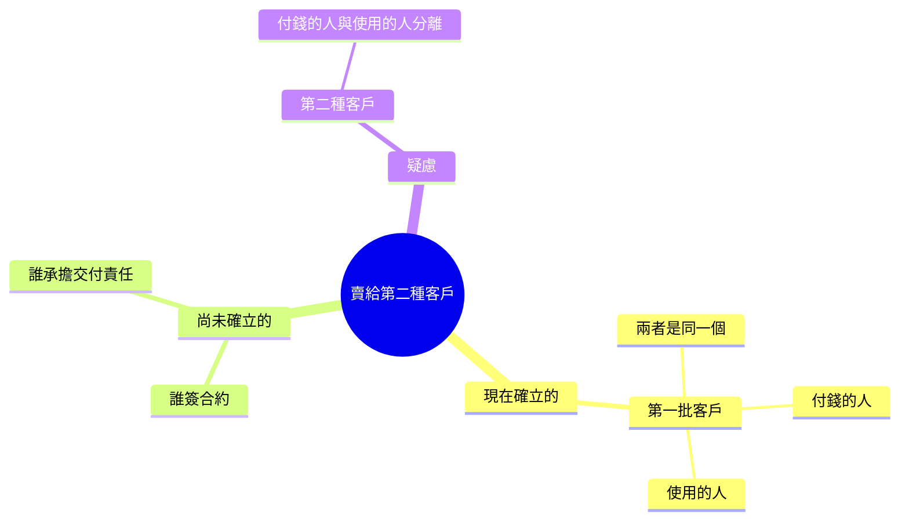
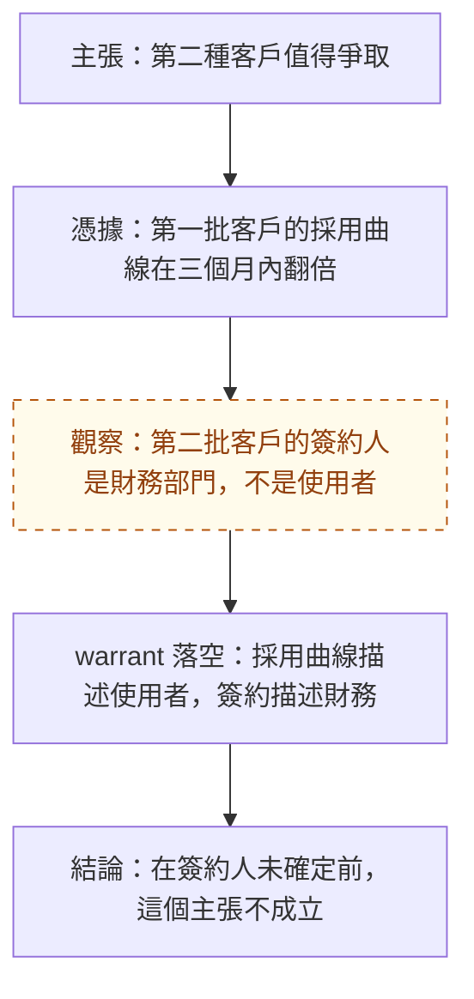
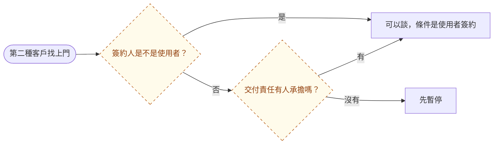
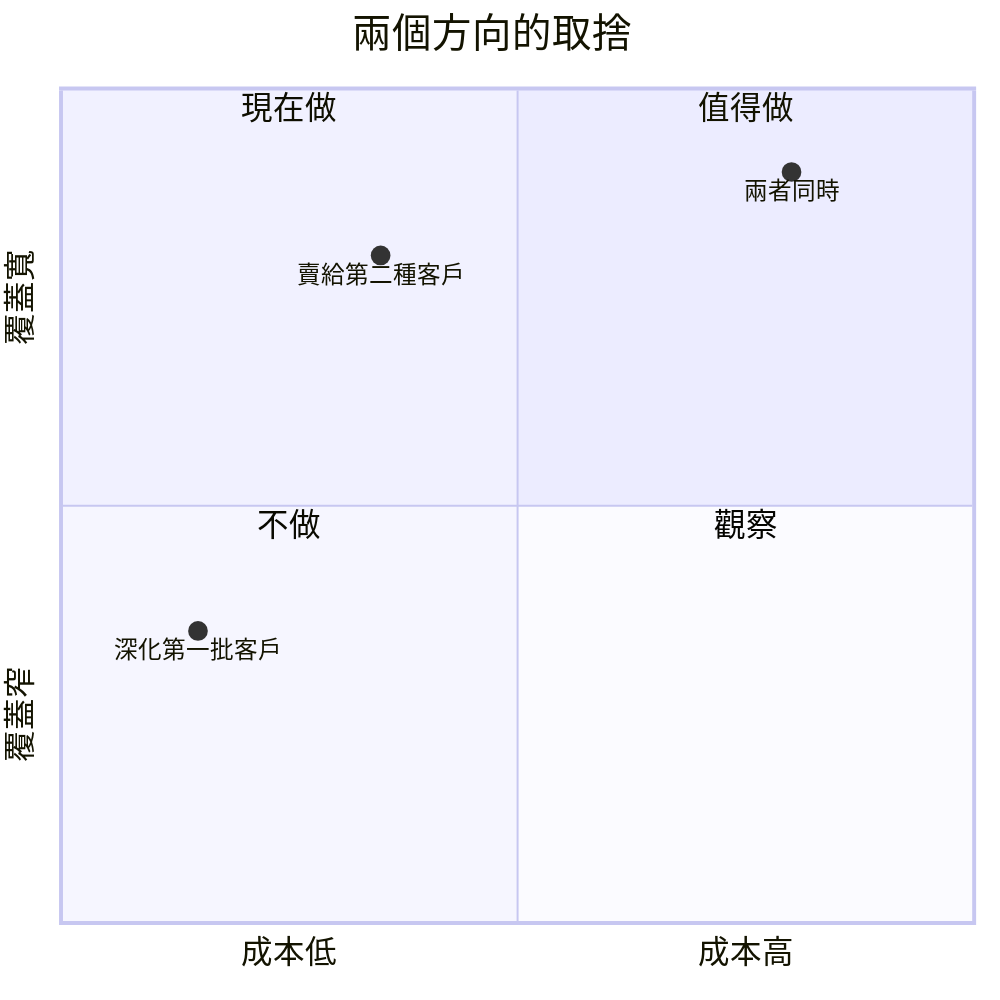
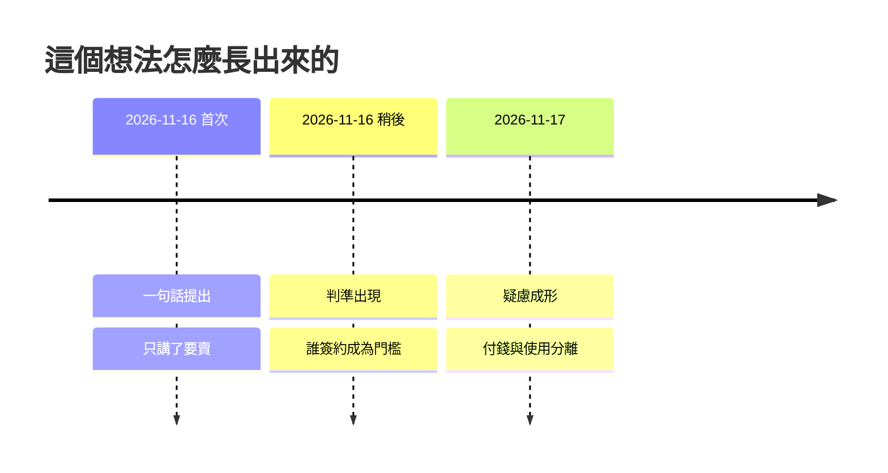
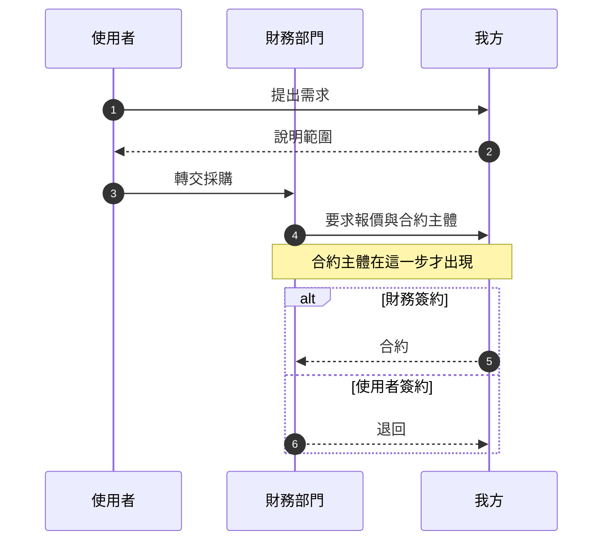
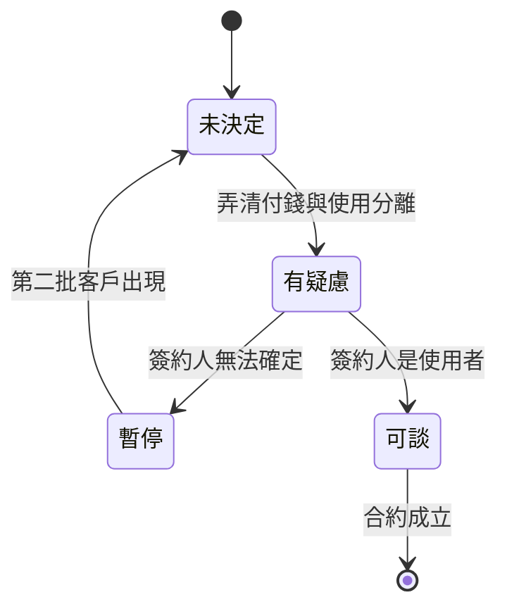
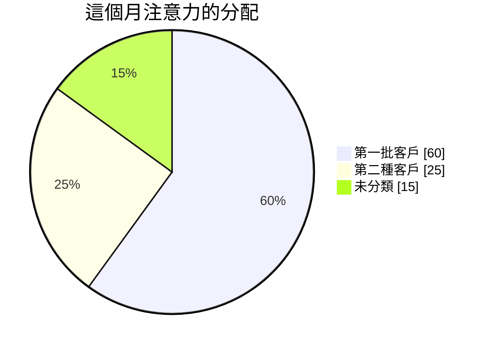

# Mermaid templates for a thought summary

Eight types, each rendered with mermaid-cli (v11/v12) before being written here: a template that did
not render is not in this file. All eight sit in the **stable tier** — they survive GitHub, GitLab,
VS Code and Obsidian, which matters because a summary gets pasted into documents.

Every block is worked on the same sample topic so the set can be read as one whole:

> 主題：是否把現有服務賣給第二種客戶。已確立：第一批客戶付錢也用；疑慮：第二種客戶的使用者與付錢
> 的人不是同一個。未確立：誰簽合約。

Two habits are baked into every block and are not optional:

- the first line is `%% source:` naming the summary lines the diagram rests on — the render script
  fails a file without it, because a diagram with no source is an invented diagram;
- label vocabulary is copied from the summary's 「詞的用法」 section, never replaced with a synonym
  the user did not use.

---

## 1. `mindmap` — what the thing is made of

**Choose it when** the summary has sections, branches and sub-branches: the reader needs the shape of
the whole, not the order of anything. It is the default first diagram.

**Do not choose it when** an edge would mean "therefore" or "if". A mindmap has no arrows for good
reason; forcing causality into it produces a tree that claims a logic it does not have.



**Pitfalls.** Indentation *is* the hierarchy — one stray space re-parents a branch. `root((…))` sets a
circle; a plain `root` makes a rounded box. Keep every node under ~10 characters, or the layout
sprawls into an unreadable fan.

---

## 2. `flowchart TD` — the argument, step by step

**Choose it when** the summary contains a claim and the warrant under it, plus the observation that
would break it. The reader needs to walk the chain and see where it stops.

This is the diagram that carries the writing rule from `brainstorming`: the negative conclusion sits
at the end of a constructed chain, never at the start.



**Pitfalls.** ```` ```mermaid ```` inside a `%%`-commented line breaks the block — keep comments on
their own line. A label holding any of `( ) [ ] { } : |` needs the whole label in double quotes. Four
to seven nodes is the useful range; a chain of twelve is a paragraph wearing boxes.

---

## 3. `flowchart` with decisions — where the judgement forks

**Choose it when** the summary names conditions: 「如果 A，就 B」, 「只有在 C 成立時才算」. The reader
needs the fork, not the reasoning behind it.



**Pitfalls.** Every edge out of a diamond carries its outcome (`是` / `否` / the actual condition);
an unlabelled edge out of a decision is a branch the reader cannot follow. Diamonds multiply badly —
past three, the diagram is a truth table and a table is the right form.

---

## 4. `quadrantChart` — the trade-off, as a space

**Choose it when** the summary ranks options against two criteria that pull against each other. The
reader needs to see *position*, not sequence. Two axes, no more.



**Pitfalls.** The axes must be the criteria the summary actually uses; inventing a plausible second
axis adds a judgement the user never made. Point coordinates are the agent's placement — say so in
the caption, or omit the chart. Quote point names containing spaces.

---

## 5. `timeline` — how the thought moved

**Choose it when** `qa.md` spans sessions and the summary records a change of mind: a criterion that
arrived late, a question that was closed. The reader needs the order of the *thinking*, not of events
in the world.



**Pitfalls.** Dates come from the record, never from memory. A timeline of *decisions* is a
`gitGraph`; a timeline of *thoughts* is this one. Keep the third field short — long text turns each
row into a paragraph.

---

## 6. `sequenceDiagram` — who does what, in what order

**Choose it when** the summary has more than one actor and the order of their actions decides the
outcome: 「客戶 A 先確認，供應方才報價」.



**Pitfalls.** `participant X as 名稱` is required to avoid the box being the raw id. `alt/else/end`
must be balanced or the whole block fails. A sequence diagram of one actor is a flowchart.

---

## 7. `stateDiagram-v2` — which state the decision is in

**Choose it when** the summary describes something that moves between discrete conditions and the
question is "what may happen next from here".



**Pitfalls.** Transitions carry the trigger after `:`; a bare `A --> B` names no cause. Terminal
states need `--> [*]`, otherwise the graph reads as if the process continues.

---

## 8. `pie` — how the whole divides

**Choose it when** the summary says what proportion of something goes where — attention, revenue,
effort. One dimension only; the reader needs shares, not sequence.



**Pitfalls.** `pie` cannot show change over time or comparison across two wholes — that is two pies
or a bar chart, and a bar chart is not in the stable tier. Percentages must be numbers the record
holds; an "about a third" turned into `33` is an invented figure.

---

## Reading this set as a whole

| The summary says… | The reader must… | Type |
| --- | --- | --- |
| these things belong to this thing | hold the shape | `mindmap` |
| this follows from that | walk the chain | `flowchart TD` |
| if this, then that | see the fork | `flowchart` + decisions |
| these options differ on two criteria | see the position | `quadrantChart` |
| the thinking changed | see the order | `timeline` |
| several actors, one sequence | see who moves first | `sequenceDiagram` |
| it is now in one of n conditions | see what may come next | `stateDiagram-v2` |
| the whole divides into shares | see proportion | `pie` |

Nothing outside this table is needed for a thought summary. `erDiagram` and `classDiagram` describe
stored shapes and code types, which a summary does not contain; `gantt` schedules work, which the
summary deliberately does not become.

## Syntax that bites, in these types specifically

| Symptom | Cause | Form |
| --- | --- | --- |
| whole block rejected | an unbalanced `end` in `flowchart`, `alt` in `sequenceDiagram` | count them |
| label truncated at a bracket | `(`, `[`, `]`, `:`, `|` unquoted | `A["成本 (低)"]` |
| mindmap in the wrong shape | indentation drift | every child indents exactly one level |
| quadrant points swapped | coordinates are `[x, y]` with x first | `"name": [0.2, 0.9]` = low x, high y |
| state names collide | two states with the same text | `state "未決定" as s1` |
| timeline rows merge | a colon inside a field | keep fields colon-free, or quote the row |
| renderer reports nothing, file absent | older renderer rejects the type | stay in the stable tier |
